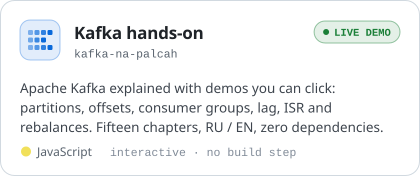
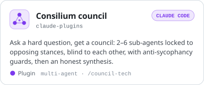
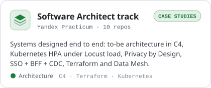
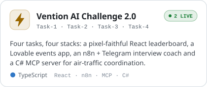
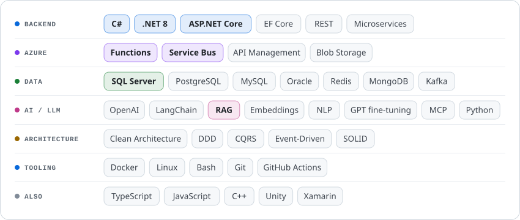
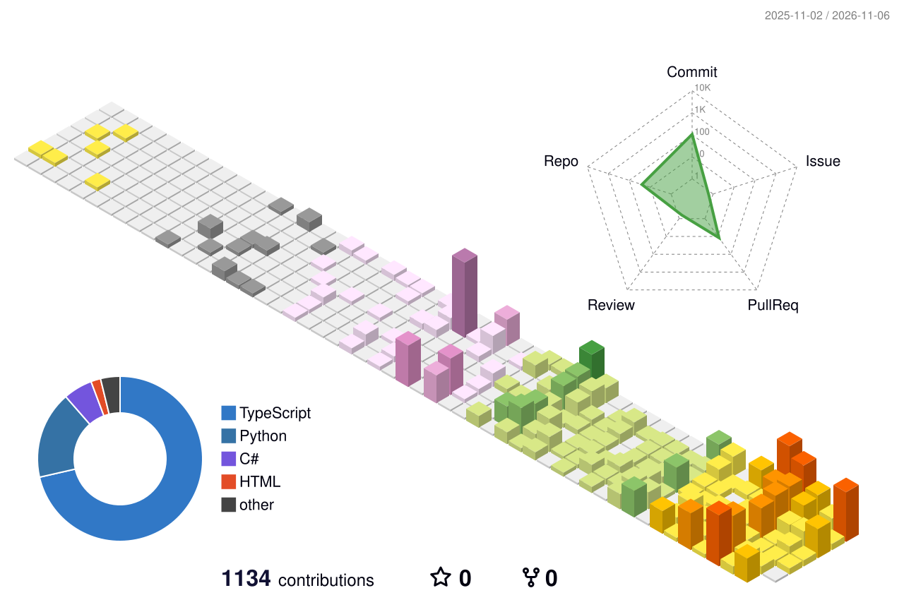
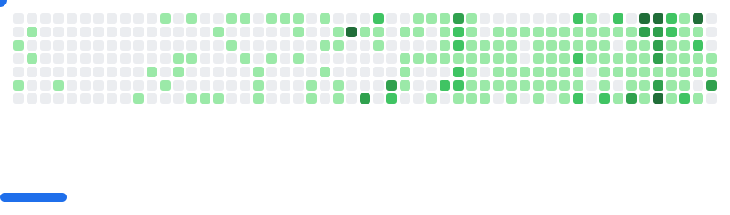
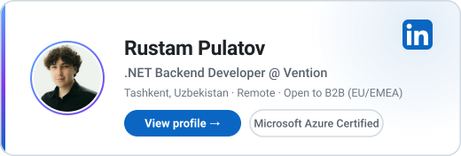

<!-- Rustam Pulatov — GitHub profile.
     Every card below is a static SVG in assets/, generated in a dark and a light
     variant by scripts/build_assets.py. Edit the content there and re-run it. -->

<a href="https://github.com/Warhammer2000">
  <picture>
    <source media="(prefers-color-scheme: dark)" srcset="assets/header-dark.svg">
    
  </picture>
</a>

  <a href="https://www.linkedin.com/in/rustam-pulatov-92abbb251/"><picture><source media="(prefers-color-scheme: dark)" srcset="assets/btn-linkedin-dark.svg"></picture></a>
  <a href="mailto:rustam.r2005@gmail.com"><picture><source media="(prefers-color-scheme: dark)" srcset="assets/btn-email-dark.svg"></picture></a>
  <a href="https://t.me/kolobokqx"><picture><source media="(prefers-color-scheme: dark)" srcset="assets/btn-telegram-dark.svg"></picture></a>

## 👋 About

.NET backend developer at **Vention** with 5+ years of shipping high-load systems: microservices on **Microsoft Azure**, and lately the AI/LLM tooling around them. In a past life I shipped engine-level features for **Space Engineers** (5M+ players) in C# and C++.

- 🔭 **Now:** AI-powered internal tooling and high-throughput file pipelines on Azure
- 🌱 **Learning:** system design, distributed systems, applied LLM engineering
- 💬 **Ask me about:** .NET 8, ASP.NET Core, EF Core, Azure (Functions · Service Bus · APIM), RAG
- 🤝 **Open to:** remote B2B contracts with EU/EMEA teams, working EU business hours from Tashkent (UTC+5)
- 🗣️ **Languages:** English · Русский · Oʻzbek

## 🚀 Featured projects

  <a href="https://github.com/Warhammer2000/kafka-na-palcah"><picture><source media="(prefers-color-scheme: dark)" srcset="assets/project-kafka-dark.svg"></picture></a>
  <a href="https://github.com/Warhammer2000/claude-plugins"><picture><source media="(prefers-color-scheme: dark)" srcset="assets/project-council-dark.svg"></picture></a>
  <a href="https://github.com/Warhammer2000?tab=repositories&amp;q=architecture"><picture><source media="(prefers-color-scheme: dark)" srcset="assets/project-architect-dark.svg"></picture></a>
  <a href="https://github.com/Warhammer2000?tab=repositories&amp;q=Task-"><picture><source media="(prefers-color-scheme: dark)" srcset="assets/project-ai-challenge-dark.svg"></picture></a>

  <b>Live:</b>
  <a href="https://warhammer2000.github.io/kafka-na-palcah/?lang=en">Kafka hands-on</a> ·
  <a href="https://warhammer2000.github.io/Task-1/">The Clone Wars Leaderboard</a> ·
  <a href="https://task-2.lovable.app/">Null Collective Events</a>
   
  <b>More:</b>
  <a href="https://github.com/Warhammer2000/text-autocomplete">text-autocomplete</a> (LSTM vs DistilGPT2) ·
  <a href="https://github.com/Warhammer2000/CalorieAI">CalorieAI</a> (calories from a photo) ·
  <a href="https://github.com/Warhammer2000/RPG-2D">RPG-2D</a> (Unity) ·
  <a href="https://github.com/Warhammer2000?tab=repositories">all repositories →</a>

## 🛠️ Tech stack

<picture>
  <source media="(prefers-color-scheme: dark)" srcset="assets/stack-dark.svg">
  
</picture>

## 📜 Certifications

<picture>
  <source media="(prefers-color-scheme: dark)" srcset="assets/certs-dark.svg">
  
</picture>

## 📊 Stats & arcade

<b>3D contribution graph and deep metrics</b>

 

<picture>
  <source media="(prefers-color-scheme: dark)" srcset="profile-3d-contrib/profile-night-rainbow.svg">
  
</picture>

<b>🎮 My contribution graph, eaten three ways</b> (snake · pac-man · breakout, regenerated daily)

 

<picture>
  <source media="(prefers-color-scheme: dark)" srcset="https://raw.githubusercontent.com/Warhammer2000/Warhammer2000/output/github-contribution-grid-snake-dark.svg">
  
</picture>

<picture>
  <source media="(prefers-color-scheme: dark)" srcset="https://raw.githubusercontent.com/Warhammer2000/Warhammer2000/output-pacman/pacman-contribution-graph-dark.svg">
  
</picture>

<picture>
  <source media="(prefers-color-scheme: dark)" srcset="https://raw.githubusercontent.com/Warhammer2000/Warhammer2000/github-breakout/images/breakout-dark.svg">
  
</picture>

## 🤝 Let's talk

  <a href="https://www.linkedin.com/in/rustam-pulatov-92abbb251/">
    <picture>
      <source media="(prefers-color-scheme: dark)" srcset="assets/linkedin-card.svg">
      
    </picture>
  </a>

  <a href="mailto:rustam.r2005@gmail.com">rustam.r2005@gmail.com</a> ·
  <a href="mailto:rustampulatovwh@gmail.com">rustampulatovwh@gmail.com</a> ·
  <a href="https://t.me/kolobokqx">Telegram</a>
    
  <em>Open to remote B2B engagements with EU/EMEA teams. Let's build something at scale.</em>
    
  

